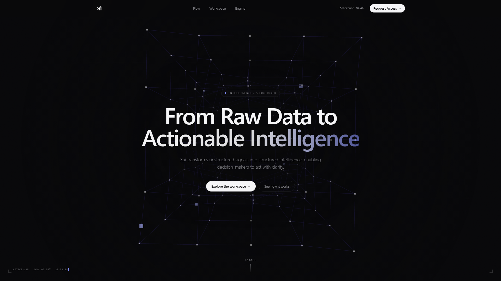
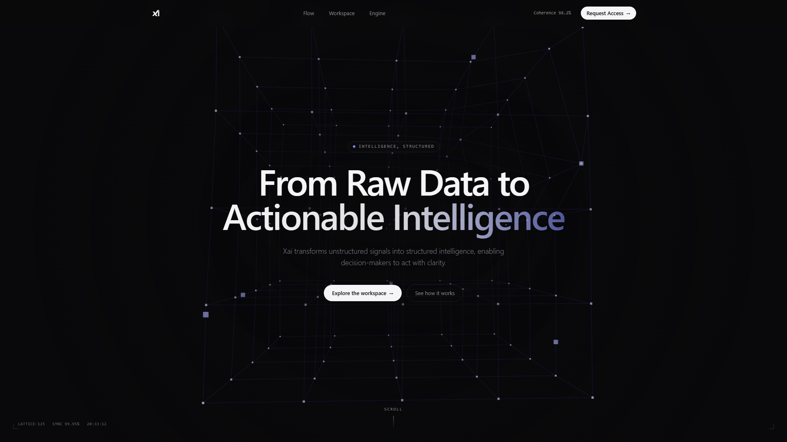
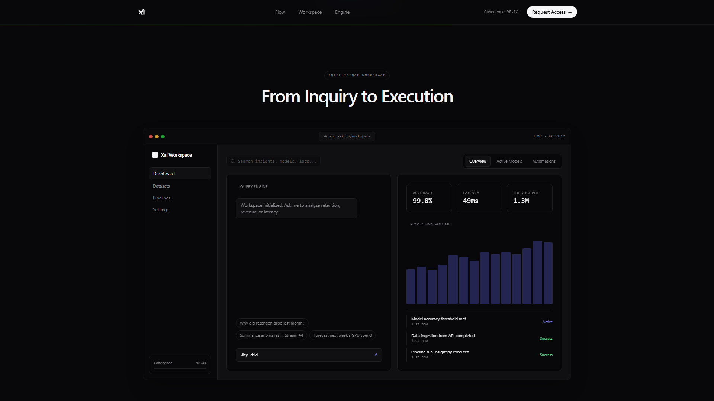
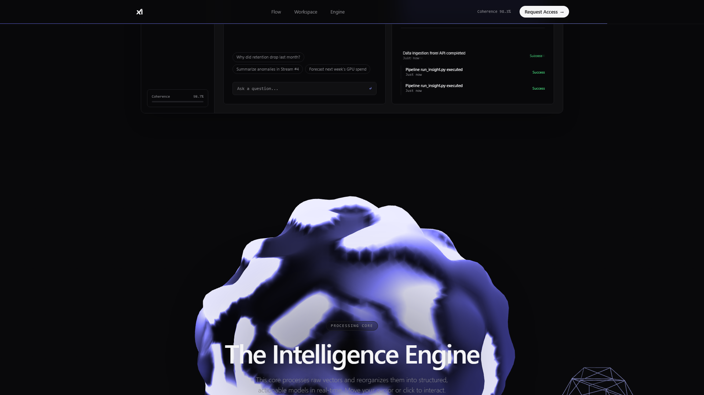
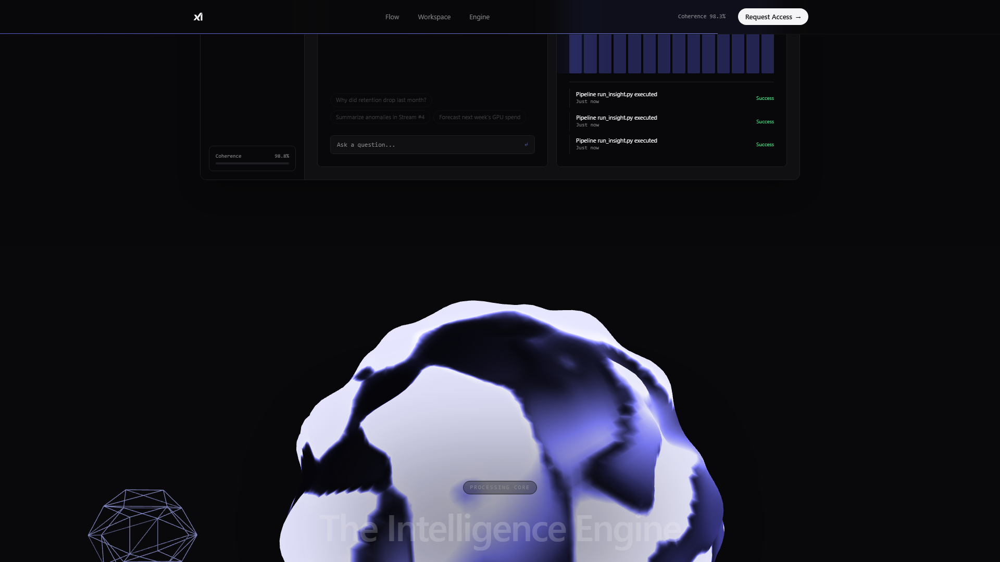
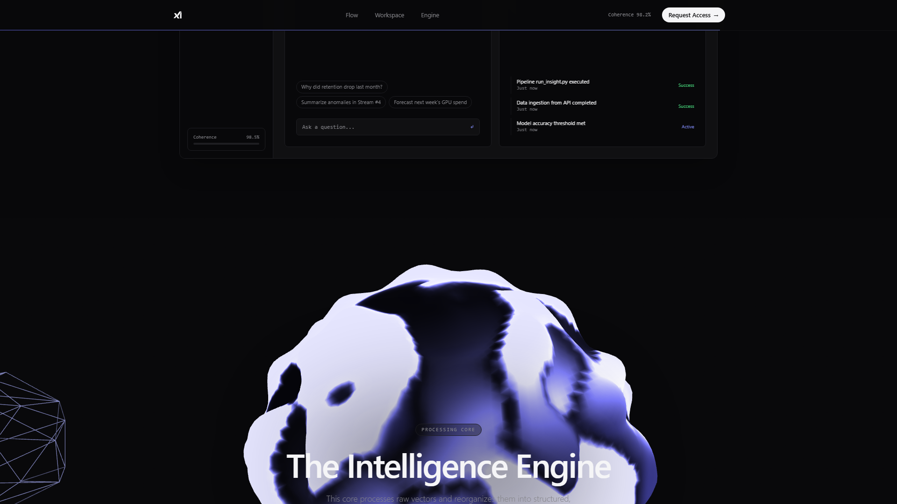

# Xai — Intelligence Workspace

A design-forward marketing surface for an AI intelligence product: a WebGL data
lattice hero, a scroll-driven "insight flow", a live product dashboard preview,
and a custom-shader signature interaction. Built to feel closer to the
Stripe / Linear / Vercel bar than a generic "AI dark mode" template.

Live sections: **Hero → Insight Flow → Workspace → Intelligence Engine → Footer.**

## Demo video & screenshots

**[▶ Watch the narrated demo video](./docs/xai-frontend-demo-narrated.mp4)** (1 min 51 s, 1080p, English narration)

The video walks through the hero data-lattice (live WebGL, cursor-driven vortex), the scroll-driven insight flow, the workspace dashboard preview, the intelligence-engine signature interaction, and the footer — with the real production build rendering at 1080p. Every frame was captured from the actual running app.

| | |
|---|---|
|  |  |
| **Hero — WebGL data lattice** | **Cursor-driven vortex interaction** |
|  |  |
| **Insight Flow (scroll-driven)** | **Intelligence Engine — signature interaction** |
|  |  |
| **Workspace — dashboard preview** | **Footer** |

---

## Stack

| Concern            | Choice |
| ------------------ | ------ |
| Framework          | Next.js 14 (App Router) |
| Language           | TypeScript (strict) |
| Styling            | Tailwind CSS 3 (token-driven) |
| 3D / GPU           | three.js + `@react-three/fiber` |
| Scroll motion      | GSAP + ScrollTrigger |
| UI motion          | Framer Motion |

## Getting started

```bash
npm install
npm run dev      # http://localhost:3000
```

Other scripts: `npm run build` (production build), `npm run start` (serve the
build), `npm run lint`.

> **Note:** Node 18+ is required. If you're viewing this running on a remote
> machine, `localhost:3000` refers to *that* machine — run the steps above
> locally to open it in your own browser.

---

## Architecture

```text
xai-workspace/
├── src/
│   ├── app/
│   │   ├── globals.css       # Design tokens, type scale, custom utilities (.grid-bg)
│   │   ├── layout.tsx        # Root layout, Inter font, <html> theming
│   │   └── page.tsx          # Section composition
│   ├── components/
│   │   ├── Navbar.tsx              # Blurred fixed nav
│   │   ├── Hero.tsx               # three.js 3D data lattice with depth falloff
│   │   ├── InsightFlow.tsx        # GSAP horizontal pinned scroll, geometric cards
│   │   ├── DashboardPreview.tsx   # Live product UI (streaming AI, activity feed, counters)
│   │   ├── SignatureInteraction.tsx # Custom GLSL: normal recalculation + Fresnel
│   │   └── Footer.tsx            # Minimalist footer
│   └── tailwind.config.ts    # Design-system source of truth
├── tailwind.config.ts        # Re-exports src/tailwind.config.ts (Tailwind entry)
├── postcss.config.mjs
├── next.config.mjs
└── tsconfig.json             # `@/*` path alias → ./src/*
```

The design system is single-sourced: colors, type scale and easing live in
`src/tailwind.config.ts` and `globals.css`, and every component consumes those
tokens (`bg-background`, `text-secondary`, `tracking-tightest`, etc.) rather
than hard-coded values.

---

## Animation decisions

Each interaction is chosen to *communicate the product* (raw data → structured
intelligence), not just to decorate.

### Hero — 3D data lattice (`Hero.tsx`)
- A 6³ point grid rendered with `@react-three/fiber`. Points start scattered
  (random offsets) and **lerp into a clean lattice** on a sine loop — a literal
  "chaos → structure" metaphor.
- Line segments are rebuilt each frame from the live point positions so the
  connective mesh breathes with the points.
- Grid is kept small (6³) and lines use additive blending + low opacity for
  performance and depth. A **radial gradient overlay** fades the lattice at the
  edges so it frames the headline instead of competing with it.
- Subtle parallax: the group eases toward the pointer via `MathUtils.lerp`.

### Insight Flow — pinned horizontal scroll (`InsightFlow.tsx`)
- GSAP `ScrollTrigger` **pins** the section and translates the card track on X,
  converting vertical scroll into horizontal travel. `invalidateOnRefresh`
  keeps the distance correct on resize; triggers are cleaned up on unmount.
- Each stage has its own **geometric glyph** (scatter→converge, neural grid,
  target) plus a numbered node threaded by a continuous connector line, giving
  the three steps distinct personality and a sense of progression.
- Hover lifts the card (`-translate-y`, indigo shadow) and warms the glyph/nodes
  to the accent color.

### Workspace — live dashboard (`DashboardPreview.tsx`)
- Everything animates **only while in view** (`useInView`) to avoid wasted work.
- **Streaming AI answer**: the response types out character-by-character with a
  blinking caret, then loops — functional "live" feeling, not a static mock.
- **Live activity feed**: new timestamped events prepend on an interval with
  Framer Motion `layout` + `AnimatePresence` enter/exit transitions.
- **Count-up metrics**: a `requestAnimationFrame` cubic-ease hook animates
  Accuracy / Latency / Throughput from zero on reveal.

### Intelligence Engine — custom GLSL (`SignatureInteraction.tsx`)
- An icosahedron displaced by 3D simplex noise in the **vertex shader**.
- **Normals are recalculated** from finite differences (sampling the
  displacement at two tangent-offset points) so lighting stays accurate after
  displacement — no faceting artifacts.
- A **Fresnel rim term** in the fragment shader adds a physical, high-end edge
  glow; base color is deep indigo rather than flat black.
- Displacement intensity and noise offset **track the pointer**, so the core
  visibly reacts to the user.

---

## Notes / roadmap

- Not yet included: Figma source file, walkthrough video, and a live
  deployment. The code is deployment-ready (`npm run build` passes) and can be
  shipped to any Next.js host (e.g. Vercel).
